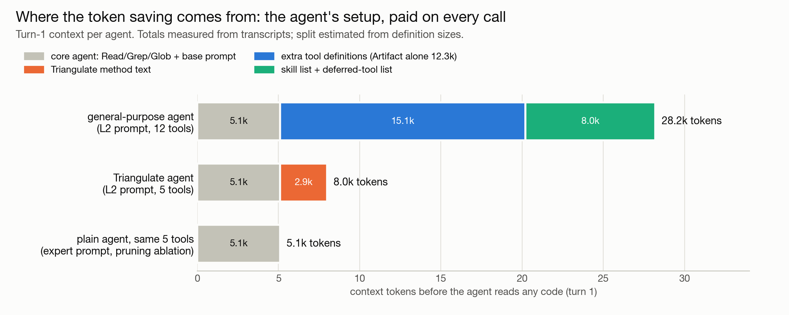
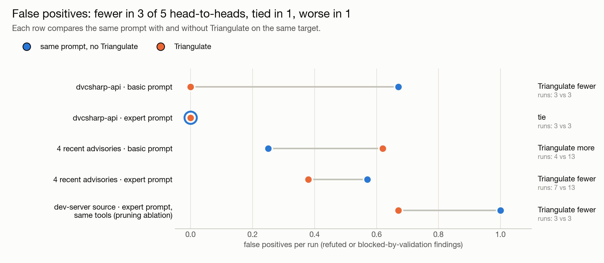

# cognitive-modes

A Claude Code plugin marketplace of type-keyed cognitive operating modes — all 16 MBTI types.

Each plugin maps a type to a set of behavioral heuristics derived from its Jungian
function stack. The type name is only an index; the payload is a concrete operating
protocol that changes how Claude approaches a task. These are behavioral scaffolds for
inducing distinct, reproducible operating styles — not a claim that the types are
validated cognitive science.

## Plugins

| Plugin      | Stack | Mode                     | Skill(s)                              |
|-------------|-------|--------------------------|---------------------------------------|
| `entp-mode` | Ne/Ti | Divergent generation     | `entp-ideation`, `entp-inversion`     |
| `intp-mode` | Ti/Ne | System building          | `intp-system-building`                |
| `intj-mode` | Ni/Te | Theory testing           | `intj-theory-testing`                 |
| `entj-mode` | Te/Ni | Execution planning       | `entj-execution-planning`             |
| `infj-mode` | Ni/Fe | Assessment (artifacts)   | `infj-assessment`                     |
| `infp-mode` | Fi/Ne | Values alignment         | `infp-values-alignment`               |
| `enfj-mode` | Fe/Ni | Facilitation             | `enfj-facilitation`                   |
| `enfp-mode` | Ne/Fi | Possibility & momentum   | `enfp-possibility`                    |
| `istj-mode` | Si/Te | Procedure & compliance   | `istj-procedure`                      |
| `isfj-mode` | Si/Fe | Stewardship & docs       | `isfj-stewardship`                    |
| `estj-mode` | Te/Si | Operations & delivery    | `estj-operations`                     |
| `esfj-mode` | Fe/Si | Coordination & consensus | `esfj-coordination`                   |
| `istp-mode` | Ti/Se | Troubleshooting          | `istp-troubleshooting`                |
| `isfp-mode` | Fi/Se | Aesthetic & craft        | `isfp-craft`                          |
| `estp-mode` | Se/Ti | Rapid response           | `estp-rapid-response`                 |
| `esfp-mode` | Se/Fi | Engagement & experience  | `esfp-engagement`                     |

## Composite agents

Beyond the 16 type-keyed skills, this marketplace also includes composite agentic
modes — subagents that chain two type-modes together into an autonomous loop rather
than a single invocable behavior.

| Plugin                    | Chain      | Mode                                | Agent                 |
|----------------------------|------------|--------------------------------------|------------------------|
| `diverge-triangulate-mode` | Ne/Ti → Ni → Ti → Te+Si → Te | Diverge → synthesize → sharpen → triangulate → route | `diverge-triangulate` |

`diverge-triangulate` is organized by function, not by type — the ENTP/INTJ/ISTJ labels
are an index for readers who think in MBTI terms, not the structure itself. It runs a
7-phase loop: **Ne** diverges a wide field of candidates; **Ti** thins it down to
internally coherent survivors, without yet checking anything external; **Ni** looks for a
single unifying pattern across the survivors (perceived, not certified — a synthesis is
just another candidate, put through the same scrutiny as the rest); **Ti** sharpens each
surviving claim into something falsifiable; **Te** (plus **Si** for one angle)
triangulates each claim from up to six independent angles — empirical, logical,
analogical, adversarial, practical, and precedent (Si: does documented history already
confirm or contradict this, distinct from Te's fresh outward search, and skipped when no
real track record exists); **Te** reads the convergence verdict and routes — promote,
scope, or discard. Si is deliberately scoped to one angle rather than a whole phase: it's
ENTP's inferior function, its structural blind spot, which is exactly why triangulation
needs a third position to cover it. The agent runs autonomously and reports back only
with a verdict.

### Benchmarks

`diverge-triangulate` was benchmarked on security code review: 75 runs over 6 targets, compared head-to-head with the same prompts run without it. Due to data sensitivity and existing bugs discovered. Basic Data Sanitization was done to avoid identification.

- **Token cost:** about 50% fewer input tokens and 36–42% lower cost with caching priced in, for the same prompt on the same targets. The saving comes from the agent's narrow `tools:` allowlist, which drops about 20k tokens of session overhead from every API call, not from the triangulation method. With tools matched, the method saved nothing.
- **False positives:** fewer in 3 of 5 head-to-heads. The effect is clearest when Triangulate is stacked on an expert prompt: false positives fell from 0.57 to 0.38 per run, and unverifiable claims fell by half.
- **Recall:** no measurable gain on the named advisory bugs (37% against 31% main-bug hits). On other real bugs, Triangulate found more in 3 of 5 comparisons, including 2 live-confirmed bugs against 0 when the tools were matched.

<picture>
  <source media="(prefers-color-scheme: dark)" srcset="benchmarks/images/token-setup-dark.png">
  
</picture>

<picture>
  <source media="(prefers-color-scheme: dark)" srcset="benchmarks/images/false-positives-dark.png">
  
</picture>

## Install (local test)

```
/plugin marketplace add ./cognitive-modes
/plugin install entp-mode@cognitive-modes
```

Skills are namespaced by plugin, e.g. `/entp-mode:entp-ideation`.

## Validate

```
claude plugin validate .
```
